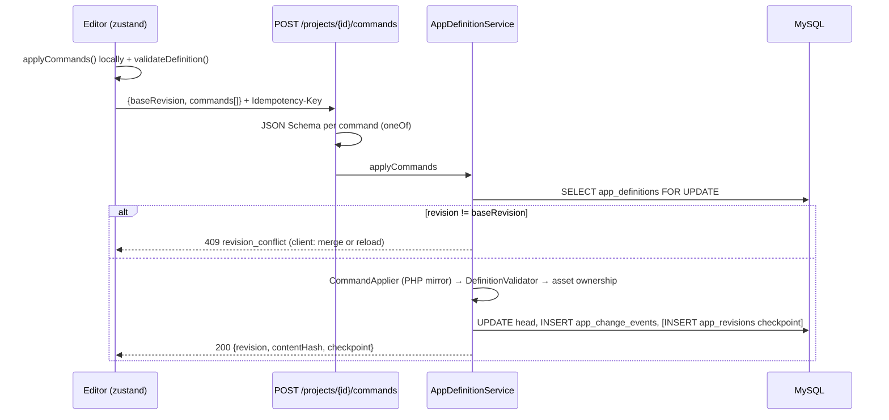

# สถาปัตยกรรมระบบ (Architecture Overview)

> สถานะ: ครอบคลุม Phase 0–1 ที่ implement แล้ว พร้อมขอบเขตที่วางไว้สำหรับ Phase 2–7
> อ้างอิงข้อกำหนด: `AI_Studio_Cloud_Master_Prompt.md` §2, §6, §7

## 1. ขอบเขตระบบ (Boundaries)

```mermaid
flowchart LR
  subgraph Browser
    S[Studio SPA<br/>apps/studio-web]
  end
  subgraph Edge
    N[nginx<br/>SPA + /api proxy<br/>CSP, headers]
  end
  subgraph ControlPlane[Control plane — apps/platform-api (Laravel 13)]
    A[Auth / Sanctum SPA session]
    T[Tenancy: orgs, workspaces, roles]
    P[Projects]
    SR[Schema registry<br/>commands → validate → revision]
    AS[Assets: sniff, re-encode, scan, quota]
    AU[Audit log / Idempotency]
  end
  subgraph Shared[Shared packages]
    SC[app-schema<br/>JSON Schema + commands + validators]
    CR[component-registry<br/>allowlist]
    R[renderer<br/>safe React renderer]
    TP[templates]
  end
  DB[(MySQL 8)]
  RD[(Redis: cache, queue, session)]
  OS[(Object storage<br/>tenant-prefixed, private)]
  W[Workers<br/>queue:work]

  S -->|same-origin /api/v1| N --> A & T & P & SR & AS
  SR --> DB
  P --> DB
  AS --> OS
  A --> RD
  W --> DB & RD
  S -. uses .-> SC & CR & R
  SR -. validates with .-> SC & CR
  TP -. seeded .-> DB
```

| Boundary (spec §2) | Implemented now | Location |
|---|---|---|
| A. Control plane | auth, orgs/workspaces, plans/entitlements (basic), projects, audit, idempotency | `apps/platform-api` |
| B. Studio | dashboard, canvas, layers, pages, assets, theme, versions, inspector, preview | `apps/studio-web` |
| C. Schema registry | versioned `AppDefinition`, JSON Schema, semantic validator, commands, checkpoints, change log, content hash | `packages/app-schema`, `app/Domain/Schema` |
| D. App data plane | **Phase 2** (data models, records, app users) | — |
| E. Runtime | renderer package (shared with preview); published runtime **Phase 4** | `packages/renderer` |
| F. Deployment | **Phase 4** | — |
| G. Workers | queue worker container wired; jobs arrive with Phase 2+ (scans are sync in Phase 1) | `docker-compose.yml` |
| H. Observability | health probe, structured Laravel logs, audit log; tracing/metrics **Phase 6** | `/api/health` |

## 2. เส้นทางคำขอ (Request paths)

**Studio (implemented):**
`browser → nginx (CSP) → /api/v1 → Sanctum session + CSRF → policy (workspace membership; non-member = 404) → service → MySQL`

**Schema mutation (implemented):**


**Published runtime (Phase 4, designed):** `DNS/TLS → edge/WAF → Host resolver (validated host, trusted proxies only) → immutable release manifest → renderer → allowlisted actions → tenant-scoped data`.

## 3. Canonical schema

- `AppDefinition` v1 (`packages/app-schema/schema/app-definition.schema.json`): `schemaVersion, projectId, name, pages[], routes[], components{}, designTokens, dataModels[], permissions[], actions[], workflows[], integrations[], assets[], seo, settings`.
- Components are a **flat map** keyed by stable id with `children: id[]` (cheap lookups, easy referential checks). Pages point to a `Page` root component.
- Sections reserved for later phases (`dataModels`, `permissions`, `actions`, `workflows`, `integrations`) are constrained to `maxItems: 0` in v1, so nothing unsupported can be stored before its validator exists.
- `assets[]` is **derived** (sorted unique `asset:<id>` references) and must match; the server additionally checks each id belongs to the project's workspace.
- All changes are typed commands: `component.insert|remove|move|update`, `page.add|remove|update`, `tokens.update`, `site.update`. The client reducer returns inverse commands (undo/redo); the server applies the same semantics in PHP.
- **Parity**: `packages/app-schema/fixtures/*.json` are produced by the TS reference implementation and asserted by both Vitest and PHPUnit (`SchemaParityTest`).

## 4. Data model (Phase 0–1)

Control plane tables: `users, sessions, password_reset_tokens, plans, organizations, organization_members, workspaces, workspace_members, projects, project_favorites, app_definitions (head), app_revisions (immutable checkpoints), app_change_events (append-only), templates, template_versions, assets, audit_logs, idempotency_keys` (+ Laravel `cache`, `jobs`).

Tenant boundary columns: every project/asset row carries `organization_id` and `workspace_id`; authorization is always derived from the **authenticated user's membership**, never from an id supplied by the client.

Primary keys are ULIDs (non-enumerable) for all externally addressed entities.

## 5. Security model (summary)

See `docs/security/threat-model.md`. Key controls in Phase 1: allowlisted components/styles/URLs, no HTML injection paths, server-side re-validation of every document, 404 for cross-tenant access, signed short-lived asset URLs, image re-encoding, CSRF via Sanctum, rate limits, audit log, idempotency keys.
